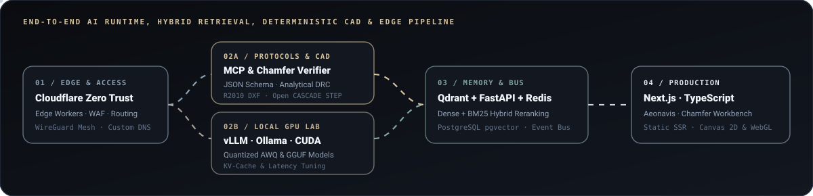
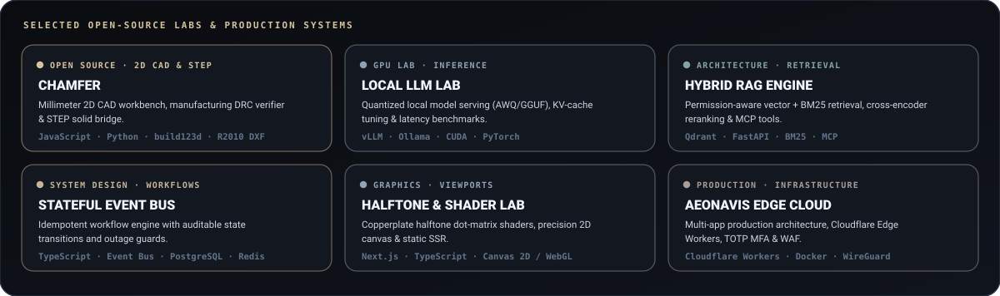

  

    

  

 

### Systems & Runtime Architecture

  

 

### 3D Isometric Architecture Topology

  

 

### Selected Open-Source Labs & Production Systems

  

  <a href="https://github.com/hasanyahsitr/chamfer"><b>Chamfer Repository</b></a> ·
  <a href="https://hasanyahsitr.github.io/chamfer/"><b>Chamfer Live Workbench</b></a> ·
  <a href="https://hasanyahsitr.github.io/chamfer/?preset=fault"><b>DRC Repair Demo</b></a> ·
  <a href="https://hasanyahsi.com"><b>hasanyahsi.com</b></a>

---

<b>Türkçe Özeti Gör — Sistem Mimarisi, Yerel LLM ve Mühendislik Yazılımları (Aeonavis)</b>

 

### Hasan Yahşi — Aeonavis (İzmir, Türkiye)

Üretim ortamındaki **yerel dil modeli çıkarım altyapılarını (`vLLM`, `Ollama`, `CUDA`), hibrit erişim sistemlerini (`Qdrant`, `BM25`), şema doğrulamalı `MCP` sunucularını, deterministik mühendislik yazılımlarını ([Chamfer](https://github.com/hasanyahsitr/chamfer)) ve yüksek işçilikli web/edge platformlarını (`Next.js`, `Cloudflare Workers`, `Canvas / WebGL`)** uçtan uca tasarlıyor ve geliştiriyorum.

- **Açık Kaynak Mühendislik & Doğrulama ([Chamfer](https://github.com/hasanyahsitr/chamfer)):** Tarayıcı tabanlı milimetrik 2B CAD çalışma tezgahı, analitik üretim DRC doğrulayıcısı, fark önizlemeli otomatik onarım, `R2010 DXF` hattı ve Open CASCADE (`build123d`) `.step` katı model köprüsü.
- **Yerel LLM & Hibrit RAG:** `vLLM`, `Ollama` ve `llama.cpp` üzerinde `AWQ 4-bit` / `GGUF` kuantizasyon, KV-cache bellek optimizasyonu ve `Qdrant` tabanlı hibrit (`BM25 + Vektör`) yeniden sıralama hatları.
- **Uç Altyapı & Web Sistemleri:** `Next.js`, `TypeScript`, `Cloudflare Workers`, `Zero Trust WAF`, `PostgreSQL`, `Redis` ve özel `Canvas 2D / WebGL` gölgelendiricileriyle çalışan üretim platformları.

